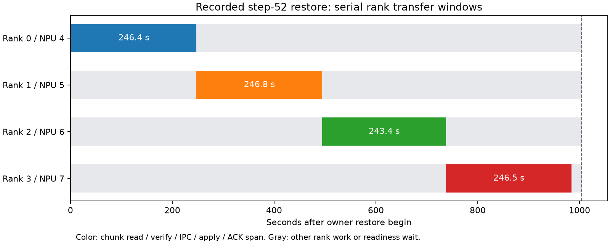
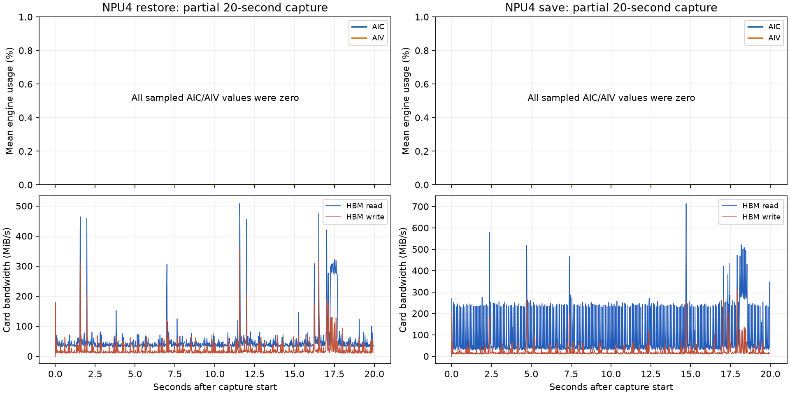

# M1 定向核验与短程续跑（2026-11-18）

本轮遵循“先定位、再小规模验证”的收尾范围：复核原始失败、做一个限量 native
请求筛查，再从 Qwen3-8B TP4 的 step 56 继续到 step 60。没有重新展开旧的
64-step、多方法、A/B 重复训练矩阵。

## 失败定位复核

原始失败发生在 step 56、rank 2 / NPU6、chunk 5221，tensor 为
`decoder.layers.26.mlp.linear_fc2.weight`。进入 `owner_payload_begin` 后没有观察到
该 chunk 的成功结束。约 60 秒后其他 rank 才取得同一 owner 锁并失败。

源码完整调用链是 `RankService → Region.payload → RegisteredBackend.write →
FullTransport.write/_request → npu_nvme_submit_transfer/wait_request → write FSM →
SPDK data qpair`。`wait_request(0)` 使用默认 60 秒观察期限；超时后关闭新准入，
保留请求/缓冲区借用，不取消设备 I/O。原始结束快照有 357,752 次 data-qpair
提交、357,751 次完成、1 个 outstanding 命令、1 个 in-flight DMA、1 组 retained buffer。

因此可以定位到“一个已提交 data-qpair 命令没有被观察到完成”。现有证据还不能
区分设备未完成、qpair 故障或 reactor 未消化完成，不能将其中一种写为根因。
`native_submitted` 事件是在成功结束后补写的，失败时缺少它本身不证明没有提交。
没有据此增加 timeout、释放未知借用或修改 native 生产实现。

## 限量 native 筛查

使用相同候选 ABI3 库（SHA256 见附件），独立 host-owner，不占用 NPU。
先只读挂载现有 Qwen raw region，再由现有 extent allocator 选出未被两份 anchor
图引用的 4 MiB 空闲区 `[668167827456, 668172021760)`。这一区间与挂载时
154,670 个受保护 extent 无重叠，不格式化、不提交 catalog generation。

| 阶段 | 写请求 | 写流量 | 阶段耗时 | API 中位数 / P99 / 最大时延 |
| --- | ---: | ---: | ---: | ---: |
| 请求计数筛查 | 66,560 × 4 KiB | 260 MiB | 75.123 s | 1.098 / 1.110 / 1.243 ms |
| 实际 chunk 路径 | 512 × 4 MiB | 2048 MiB | 6.377 s | 12.366 / 12.423 / 13.630 ms |

两段均完成 flush 和读回比对；前后三个 superblock/anchor block 的 SHA256 均为
`16447b80eda6e8df5c8842b960c6fdac77bfc8b81f66d25e8395d9b2b4531090`。
结束时 data-qpair 68,725/68,725 提交/完成，outstanding、DMA、排队写、retained、
retry、completion error 均为 0，close 成功。

这排查了跨过 65,536 次累计请求后仍能正常继续的路径；没有证据证明原始失败与
该阈值有关。总写流量仅 2308 MiB，也不等价于原始数十万次大块写、TB 级流量或
四 rank IPC 压力。不能将本次通过作为排除所有累计负载问题的证明。

**计数口径校正**：native `nvme_submit_count/complete_count` 由 data qpair 读写路径
更新；metadata qpair 的 flush/typed metadata 命令不在其中。旧 snapshot 的 scope
文字声称包含 flush 不准确。Python transfer API 计数包含 flush，不能把两者视为
同一集合。时延也包含 host copy、轮询和等待，不能当作设备服务时间。

附件：[native 结果](native-screen-result.json)、[250 ms 计数采样](native-screen-samples.jsonl)、
[输入与原始请求日志索引](input-index.json)。原始逐请求开始/结束日志留在 `/models`。

## 上轮 restore 的阶段补齐

root 事件流现已可读，补齐此前报告遗漏的恢复阶段。这里分析的是已经完成的
step 52 / catalog generation 13 / raw generation 142，不与本轮 step 56 混合统计。

Owner begin → ready 为 1004.589 s，约 1.212 s 初始化，983.164 s chunk 流，
最后一个 chunk 之后约 20.214 s 才到全局 ready。事件配对全部齐全，每 rank
6376 个 chunk：

| Rank / NPU | 相对 owner begin 的数据窗口 | 窗口跨度 | apply 区间并集 |
| --- | ---: | ---: | ---: |
| 0 / 4 | 1.212–247.657 s | 246.445 s | 46.146 s |
| 1 / 5 | 247.657–494.490 s | 246.832 s | 43.637 s |
| 2 / 6 | 494.490–737.872 s | 243.382 s | 44.028 s |
| 3 / 7 | 737.872–984.376 s | 246.504 s | 43.393 s |

Owner 按 manifest 顺序逐 rank 发送并等待 chunk ACK，源码和事件均确认该顺序。
这些区间包含读盘、hash、IPC、目标应用与 ACK；apply 并集又包含 host 拷贝/
调度，不是 AIV 算子时间。较早传完的 rank 在控制态验证/global-ready 前继续等待，
不能将其整段等待算成设备忙碌时间。

详细数据：[事件阶段表](step52-restore-event-stages.csv)、
[时钟与 ready 标记](step52-restore-event-summary.json)。

## 本轮 step 56 → 60

**结果通过，全部进程已安全结束。** 只运行四个训练步、一次保存，环境身份、LR horizon
和 TP4 映射沿用上轮。配置见 [continuation-run-config.json](continuation-run-config.json)。
最终 step 60 保存为 catalog generation 16 / raw generation 144。

| 本轮完整操作 | 四 rank 中位数 / 总体时间 |
| --- | ---: |
| Restore step 56，rank API | 989.654 s |
| Save step 60，rank backend API | 543.414 s |
| Save step 60，完整 blocking boundary | 567.814 s |
| supervisor 启动至全部安全关闭 | 1878.586 s |

保存边界的主要阶段是 capture/transport 543.637 s 与 manifest read/hash 22.766 s，
其余准入、reservation、发布等阶段见 [四 rank 保存阶段表](step60-save-stages.csv)、
[保存阶段摘要](step60-save-summary.json)。操作/阶段相互嵌套，不能将 API 总时长
再与内部阶段相加。

本轮 owner restore begin→ready 为 989.480 s：setup 1.242 s、chunk 流 971.334 s、
末尾控制态验证/global-ready 16.904 s。四 rank 的数据窗口跨度依次为
235.302、251.255、243.552、241.225 s，仍为串行 rank 顺序。
见 [本轮 restore 阶段](step56-restore-event-stages.csv) 及
[ready 标记与配对统计](step56-restore-event-summary.json)。

四 rank 恢复后的 state/control checked JSON 已与 step 56 保存记录精确比对通过，
见 [恢复状态比对](restored-step56-comparison.json)。

四 rank 的 step 57–60 共 16 个 loss 与相同源、相同环境身份的不中断 `none` 轨迹
逐值完全相同，最大绝对误差为 0，无 overflow，最终 loss 为 `0.0018733831821009517`。
这是 loss 轨迹比对；oracle 的最终完整状态在 step 64，因此没有声称 step 60 最终
state/control 与 oracle 逐字节比较。详见 [loss 比对](loss-trajectory-comparison.json)。

Owner 的 data-qpair 53,197/53,197 提交/完成，transfer API 53,200/53,200；
四 rank 的 copy executor 各记录 6302 次异步 DMA 提交。Owner 和所有 rank close
通过，native outstanding、DMA in-flight、排队写、retained buffer、retry、completion
error 均为 0。无残留子进程，hardware lease 已释放，4/4 ready 与 restore pin release
凭据均保留。见 [supervisor 结果](continuation-result.json)、
[owner 结果](continuation-owner-result.json) 及各 `rank_*` 目录。

另在实际 restore/save 的早期各采集 NPU4 一个 20 秒窗口：AIC/AIV sample-based PMU
100 Hz、整卡 HBM 50 Hz。它们是局部阶段观测，不能代表整个 TP4 或完整 checkpoint。
数据库的 engine/type 字段是每次导出的 `STRING_IDS` 引用，按字符串解析而非固定 ID。
HBM 先按同一时间戳汇总四个 stack，始终只报告整卡读/写，不拆分成引擎带宽。

| NPU4 局部窗口 | 采集时长 | AIC / AIV PMU 均值 | 整卡 HBM 读均值 / 最大值 | 整卡 HBM 写均值 / 最大值 |
| --- | ---: | ---: | ---: | ---: |
| Restore，首个 chunk 开始后 0.288 s | 20.079 s | 0 / 0% | 52.72 / 508.01 MiB/s | 22.15 / 359.53 MiB/s |
| Save，首个 payload 开始后 0.685 s | 20.079 s | 0 / 0% | 96.54 / 713.40 MiB/s | 21.58 / 310.80 MiB/s |

每个窗口包含 999 个 HBM 采样时刻，最大间隔分别为 21.87、22.83 ms。AIC/AIV
PMU 表每窗口约 4 万/8 万行，是各核心的相关采样行数，不是独立实验重复数。
两个窗口均没有正值 PMU 行。当前源码通过 native copy/DMA 传输，HBM 有流量并不
要求 AIC/AIV 核心执行算子。不能将整卡流量分配给 AIC 或 AIV，也不能把局部 20 秒
推及全部 checkpoint、其余三卡、训练计算或硬件不支持 co-run。

[原始时钟、DB 哈希和统计](checkpoint-phase-summary.json)；
[10 ms 展示桶时间序列](checkpoint-phase-timeseries-10ms.csv)。
20 ms HBM 采样之间的桶留空，不插值成更高频数据。跨时钟只用同机 launch 的
realtime/monotonic 配对近似映射，保留原始锚点，不据此声称微秒级引擎重叠。
两段窗口按该映射均落在各自完整操作区间内，
[时钟覆盖检查](phase-clock-coverage.json) 已通过；它们不覆盖全部恢复、末尾模型
装载/控制态验证或整个保存过程。

## 验证边界

- 8 项既有 Python/stubbed-C 检查通过，覆盖超时保留、迟到完成、丢失完成、early
  release 和 close retry；这些不等同于硬件故障注入验收。
- 2 项新增 SQLite 回归通过，覆盖导出间指标 ID 变化与四 HBM stack 的带宽求和。
- native 硬件限量筛查通过；原失败在此规模下未复现，内部原因尚未确认。
- 本轮四步续跑、精确恢复状态检查、loss 轨迹及局部设备采集通过；单独登记，
  不加入旧 A/B 扰动或 pooled P95。

本轮小规模功能闭环已完成；原始累计负载挂起未复现，根因仍未确认。真实 checkpoint
采样没有观察到 AIC/AIV 核心协同执行；整卡 HBM 数据与同步 DMA/主机桥接路径相符。
前一轮隔离控制的 PMU 存在正值，可作为采样功能正常的对照，但其中的 host 校验耗时
和固定顺序三次重复不支持性能收益结论。旧正式 M1 性能/扰动矩阵仍未验收，不能用本轮
小规模通过替代；也没有据此继续 TB 级写压测或扩大训练规模。

源执行工作树仍为 `0069af02b77ae1931dd7c1fec93e8920768b288e`；分析工具只在
结果工作树修改，没有改变本轮 Qwen 源身份。原始目录为
`/models/npu_nvme_exp/user7-stack/aic-aiv-m1-small-20261118/`。

结束后已对本轮临时转换权重缓存逐文件记录 SHA256，再移除 16,381,531,173 bytes
的可重建副本（约 15.26 GiB）。原始模型、checkpoint、事件与 profiler 原始数据均保留；
见 [缓存清单](converted-weight-cache-manifest.json)。NPU4–7 无残留进程，hardware
lease 已释放；[验证摘要](validation-summary.json) 与 [附件哈希](artifact-sha256.json)
一并归档。
